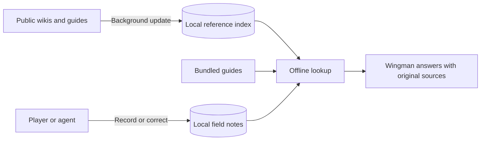

# Star Citizen WikiLLM for Wingman

Ask your Wingman a Star Citizen question and get an answer from a local library with links to the original sources. The starter guides cover flight, cargo, mining, salvage, survival and ship engineering. They work as soon as you install the skill, even before the first update.

## Install

1. Download **wiki_llm-0.1.0.zip** from [Releases](https://github.com/Fowlplaychiken/wingman-wikillm/releases/latest). Extract the `wiki_llm` folder into Wingman's **custom skills** folder. On Windows this is usually `%APPDATA%\ShipBit\WingmanAI\custom_skills`. Inside `wiki_llm` you should see `default_config.yaml`.
2. Reopen Wingman and enable **Star Citizen WikiLLM** for the Wingman you use.
3. Ask **“Use the Star Citizen wiki. What makes driving on Aberdeen difficult? Show me the sources.”**

The answer can link directly to CIG's description of sulfurous haze and the community's moon entry. For a version-specific question, try **“In 4.10.3, what does life-support load mean?”** [Aberdeen in Galactapedia](https://robertsspaceindustries.com/galactapedia/article/0qanJarxqa-aberdeen-stanton-1b) · [Aberdeen in Star Citizen Wiki](https://starcitizen.tools/Aberdeen)

## What lives on your computer

| Library | What you can ask it |
|---|---|
| Bundled field guides | Reviewed explanations with their original article links and game build where known. |
| Publisher index | Locally saved community excerpts and revision links. The wider index also includes RSI Support, Comm-Link and Galactapedia titles. A title by itself is a reading lead. |
| Your field notes | Findings and corrections added by your Wingman or by you. Each entry keeps its history, build and original link when available. A personal observation is labeled as such. |

Lookups read local files. While the skill is loaded, **Update the reference library in the background** lets it check publishers for changes. Switch that setting off for entirely offline operation. If your conversation model is hosted, Wingman still sends it the question and the excerpts it needs for the answer. A local conversation model can keep those on your machine too.

## Keep a finding

**Your field notes belong to your Windows or Linux user account.** Wingmen using that account can share the library. Other installations start with their own empty notes. The updater contacts publishers for their public pages and metadata. There is no account with this project, note upload, or synchronization of player contributions. The release ZIP is built from a fixed list of program files and public guides.

Say **“Save this as a draft field note”** when a reading still needs checking. Give your Wingman the original link or describe what you personally observed and which build you used. Ask it to review the evidence and save the checked finding. Later you can ask to correct or withdraw the same topic. Drafts stay out of ordinary answers. Reviewed observations, corrections and withdrawals keep their own revision history. Publisher updates leave your notes intact.

Your library lives in `~/.starcitizen-wiki`. Back up that directory to keep it across installs. If you already have a Star Citizen Computer wiki cache, the skill reads it in place. Set `SC_WIKI_DB` to use a different database. Wilma, a separate companion server, a tablet and an embedding model are all optional.

From a source checkout, run `python -m wiki_llm.dependencies.wingman_wiki.refresh` for a one-time update and coverage report. It reports discovered titles and saved excerpts separately. Add `--batch-size 30` to collect a larger batch at the publisher's permitted pace. An unavailable publisher can retry independently while existing entries remain readable. If the index reports that an article changed after a guide or note was reviewed, the lookup flags that claim for review.

## Sources and maintenance

Any assistant on your machine can run `python -m wiki_llm lookup "Aberdeen visibility"` from the checkout or the parent of the installed skill. The JSON result contains the same local evidence and publisher citations Wingman sees. Add `--build 4.10.3` for an exact build. Markdown guides are also directly searchable with ripgrep.

Original CIG and community pages are the authorities for published game claims. The community source is attributed to Star Citizen Wiki with revision links when available. Excerpts are collected incrementally under publisher crawl rules. The package contains original short guides. The public sites contain substantially more material than a fresh install. Update the package to receive revisions to the bundled guides. [CIG Galactapedia](https://robertsspaceindustries.com/galactapedia/) · [Star Citizen Wiki](https://starcitizen.tools/) · [Community licensing](https://starcitizen.tools/Star_Citizen_Wiki:General_disclaimer)

The note history and exact-build lookup draw on research into persistent wiki corrections and version-aware retrieval. To build the installable ZIP yourself, run `python build.py` with Python 3.11 or later. [LLM-Wiki research](https://arxiv.org/abs/2605.25480) · [VersionRAG](https://arxiv.org/abs/2510.08109)
